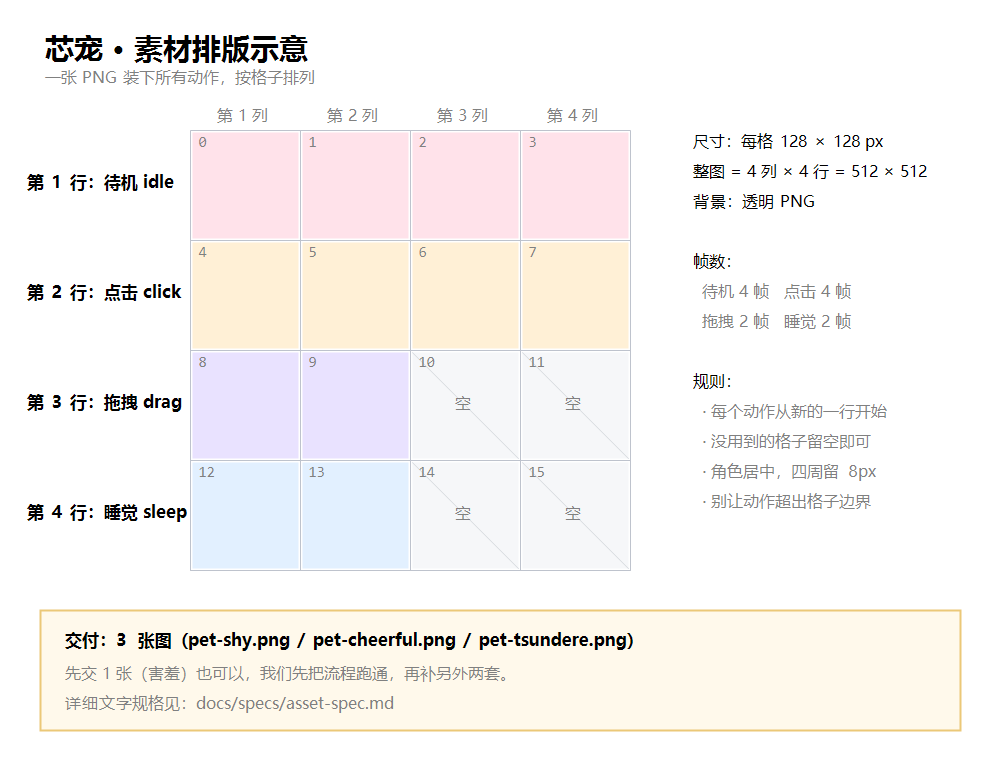

# 美术接入指引

> 给负责角色美术的同学：看完这份文档，你就能在自己电脑上跑起芯宠、替换角色图、看到实际效果。
> 全程不需要写代码，遇到不确定的地方随时问。

---

## 1. 项目是什么

**芯宠**：一个 Windows 桌面 AI 互动桌宠。它会待在桌面上，点一下有反应、会说话、会睡觉，还能切换三种性格。

现在做到的进度：

| 能力 | 状态 |
|---|---|
| 桌面悬浮、点击穿透、拖拽 | ✅ 已完成 |
| 待机 / 点击 / 拖拽 / 睡觉 四种动作 | ✅ 已完成（用的是程序画的占位图） |
| 台词气泡、音效、三种性格 | ✅ 已完成 |
| **真实角色美术** | ⬜ **等你这套图** |

也就是说：**除了形象是程序画的圆脸，其它都做好了。** 你的图一进来，它立刻就像个真正的桌宠。

---

## 2. 你要交付什么

**三个角色，每个角色一张 PNG。**

| 角色 | 配色 | 性格 |
|---|---|---|
| 害羞 shy | 粉色系 | 软软的、小声 |
| 开朗 cheerful | 橙色系 | 活泼、话多 |
| 傲娇 tsundere | 紫色系 | 嘴硬、有小脾气 |

每张图里装 4 个动作：

| 动作 | 帧数 | 画什么 |
|---|---|---|
| 待机 idle | 4 帧 | 轻轻呼吸、偶尔眨眼 |
| 点击 click | 4 帧 | 被戳到的反应（吓一跳 / 开心 / 缩一下） |
| 拖拽 drag | 2 帧 | 被拎起来，身体倾斜 |
| 睡觉 sleep | 2 帧 | 闭眼、呼吸放慢 |

排版要求见下一节的图。

---

## 3. 图怎么排



- 一张 PNG，**4 列 × 4 行**
- 每格 **128 × 128** 像素（整图 512 × 512）
- 第 1 行待机、第 2 行点击、第 3 行拖拽、第 4 行睡觉
- 每个动作从新的一行开始，没用到的格子留空
- **背景必须透明**

> 完整规格（含常见错误对照）在 [`asset-spec.md`](specs/asset-spec.md)。

---

## 4. 把项目装到自己电脑上

### 4.1 需要先装两个东西

| 软件 | 版本 | 下载 |
|---|---|---|
| Node.js | 24 或更新 | <https://nodejs.org> |
| pnpm | 10 | 装完 Node 后，在命令行执行 `npm i -g pnpm` |

### 4.2 ⚠️ 路径必须短、且全英文

**这一步最容易踩坑**：项目不能放在含中文的路径下，否则程序启动会直接崩溃、没有任何提示。

| ✅ 可以 | ❌ 不行 |
|---|---|
| `E:\xinchong` | `E:\学习\人机交互\芯宠` |
| `D:\code\xinchong` | `C:\Users\张三\桌面\xinchong` |

### 4.3 下载项目

**方法一：用 Git（推荐，以后更新方便）**

```powershell
cd E:\
git clone https://github.com/kleigsm/xinchong.git
cd xinchong
```

**方法二：不用 Git**

打开 <https://github.com/kleigsm/xinchong>，点绿色 `Code` → `Download ZIP`，
解压到 `E:\xinchong`（注意路径规则）。

### 4.4 安装并运行

```powershell
cd E:\xinchong
pnpm install
pnpm start
```

**正常的话，屏幕右下角会出现一只小宠物**，点它会动、会冒台词。

### 4.5 起不来怎么办

| 现象 | 原因 | 解决 |
|---|---|---|
| 一闪就退出，没有报错 | 路径含中文或太长 | 换到 `E:\xinchong` 这种短英文路径 |
| 报 `ELECTRON_RUN_AS_NODE` 相关 | 环境变量污染 | 先执行 `$env:ELECTRON_RUN_AS_NODE = $null` 再 `pnpm start` |
| 提示找不到 pnpm | 没装 | `npm i -g pnpm` |
| 其它报错 | — | 把完整报错截图发群里 |

---

## 5. 替换成你的图

### 5.1 放进项目

把你的 PNG 重命名后放进：

```
E:\xinchong\src\renderer\assets\
├── pet-shy.png        ← 害羞
├── pet-cheerful.png   ← 开朗
└── pet-tsundere.png   ← 傲娇
```

**文件名必须完全一致**（全小写、连字符）。

### 5.2 跑起来看效果

关掉程序（终端里按 `Ctrl + C`），重新执行：

```powershell
pnpm start
```

就能看到你的角色了。

### 5.3 尺寸不是 128 怎么办

按 128 画最省事。如果你习惯画 512，也没关系——**画完告诉我**，我改一行参数就行，你不用动代码。

---

## 6. 自己先检查一遍

交图前对照这个清单，能省一轮返工：

- [ ] 背景是**透明**的（不是白底）
- [ ] 每格都是 **128×128**，四格边长一致
- [ ] 角色在格子里**居中**，四周留约 8px 空隙
- [ ] 待机在第 1 行、点击第 2 行、拖拽第 3 行、睡觉第 4 行
- [ ] 四个动作都有，帧数对得上
- [ ] 整图是 512×512（或 2048×2048）

---

## 7. 交付方式

**直接把 PNG 发微信/QQ 给我就行**，不用管 Git。

顺便告诉我：

1. 每张图的尺寸（128 还是 512）
2. 每个动作实际画了几帧
3. 有没有你觉得还需要调的地方

**先交「害羞」这一套**，我接进去确认效果没问题，再画另外两套——这样万一有理解偏差，只损失一套。

---

## 8. 关于署名与公开

仓库是公开的（课程作业）。你的图进去之后，README 里会注明**角色美术：你的名字**。

如果对公开有顾虑，提前说，我们再商量。

---

## 9. 需要帮助

- 跑不起来：把报错截图发群里
- 不确定画成什么样：仓库里 `src/renderer/assets/pet-shy.png` 是程序画的占位角色，可以参考它的尺寸、构图和动作幅度
- 想要更自由的发挥：只要满足「4 列 × 4 行、每格 128、透明背景」，画风完全由你决定
