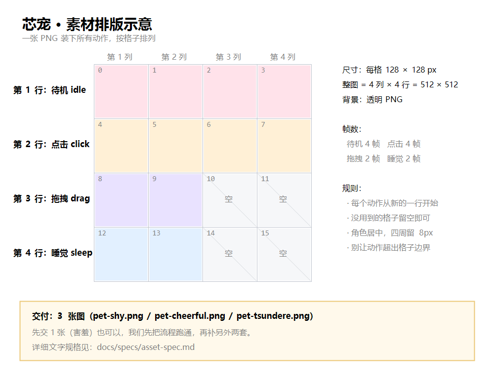

# 素材规格 v1

> **这份文档给三种人看**：美术（照着画）、用户（准备自己的角色）、程序（照着校验）。
> 有任何一条不清楚，就是文档的问题，请提出来。



> 先看上面这张图——"哪个动作放哪一格"一目了然。下面是文字版细节。

---

## 0. 一句话

**一个角色包 = 一张雪碧图 + 一份配置。**

```
shy/
├── sprite.png     ← 所有动作画在一张图上
└── pack.json      ← 说明哪个动作对应哪几格
```

---

## 1. 雪碧图（sprite.png）

| 项 | 要求 |
|---|---|
| 格式 | PNG，**必须透明背景** |
| 单格尺寸 | **128 × 128**（推荐；也可 96/160，但要能整除） |
| 网格 | **4 列**，行数按动作数决定 |
| 角色位置 | 每格居中，四周留 **8px 安全边距**（动作幅度大时不至于被裁） |
| 单图上限 | 2048 × 2048 |
| 边缘 | 不要半透明黑边（导出时别勾"杂边"） |

### 帧的编号规则

**行优先，从 0 开始**：

```
+----+----+----+----+
| 0  | 1  | 2  | 3  |  ← 第 0 行
+----+----+----+----+
| 4  | 5  | 6  | 7  |  ← 第 1 行
+----+----+----+----+
| 8  | 9  |    |    |  ← 第 2 行（可以不满）
+----+----+----+----+
```

**每个动作必须从新的一行开始**，不能两个动作挤在同一行。

---

## 2. 必须的四个动作

| 动作 | 名字 | 帧数 | 帧率 | 循环 | 画什么 |
|---|---|---|---|---|---|
| 待机 | `idle` | 4–8 | 8 fps | 是 | 呼吸起伏、偶尔眨眼 |
| 点击 | `click` | 3–6 | 12 fps | 否 | 被戳到的反应：惊讶 / 开心 / 缩一下 |
| 拖拽 | `drag` | 2–4 | 6 fps | 是 | 被拎起来：倾斜、晃动 |
| 睡觉 | `sleep` | 2–4 | 2 fps | 是 | 闭眼、呼吸放慢 |

> `idle` **必须排在第 0 行**，程序默认从这一行开始播。

### 帧数怎么算

- 待机 4 帧 @8fps = 每 0.5 秒循环一次，够用
- 点击 4 帧 @12fps ≈ 330ms，播完自动回待机
- 不要超过上表上限——帧数越多，图越大，加载越慢

---

## 3. 配置文件（pack.json）

```json
{
  "id": "shy",
  "name": "害羞",
  "sprite": {
    "frameWidth": 128,
    "frameHeight": 128,
    "columns": 4,
    "rows": 4
  },
  "animations": {
    "idle":  { "frames": [0, 1, 2, 3], "fps": 8,  "loop": true },
    "click": { "frames": [4, 5, 6, 7], "fps": 12, "loop": false },
    "drag":  { "frames": [8, 9],       "fps": 6,  "loop": true },
    "sleep": { "frames": [12, 13],     "fps": 2,  "loop": true }
  },
  "lines": {
    "click":    ["……诶？", "别、别突然戳我啦"],
    "drag":     ["要掉下去了……！"],
    "idleLong": ["……你在忙吗"],
    "sleep":    ["呼……呼……"]
  }
}
```

### 台词要求

| 场景 | 条数 | 单条长度 |
|---|---|---|
| `click` | 8–20 条 | ≤ 20 字 |
| `drag` | 3–8 条 | ≤ 20 字 |
| `idleLong` | 3–8 条 | ≤ 20 字 |
| `sleep` | 2–5 条 | ≤ 20 字 |

- 不用句号结尾（气泡里显得啰嗦）
- 可以带括号表示动作，如「（脸红）」

---

## 4. 音效（可选，v1 不强求）

| 项 | 要求 |
|---|---|
| 格式 | mp3 或 wav |
| 时长 | ≤ 3 秒 |
| 命名 | 与动作对应，如 `click_1.mp3`、`idle_1.mp3` |
| 音量 | 统一响度，不要有突然的爆音 |

放不进 v1 可以先不做——**没有音效不影响角色可用**。

---

## 5. 交付前自查表

画完对照打勾，少一条都会导致导入失败：

- [ ] 背景是**透明**的（不是白色）
- [ ] 每格都是 **128×128**，尺寸完全一致
- [ ] 角色在格子里**居中**，没有贴边
- [ ] `idle` 在第 0 行
- [ ] 四个动作齐全，每个都从**新的一行**开始
- [ ] 帧数在要求范围内（idle 4–8、click 3–6、drag 2–4、sleep 2–4）
- [ ] 整张图 ≤ 2048×2048
- [ ] `pack.json` 里的 `frames` 编号与图上位置一致
- [ ] 台词每类条数达标

---

## 6. 常见错误（每一条都真实会犯）

| 错误 | 会看到什么 | 怎么改 |
|---|---|---|
| 背景是白的 | 桌面上出现一个白方块 | 导出时勾选「透明背景 / Alpha 通道」 |
| 每格尺寸不一致 | 动作错位、串到别的格 | 用同一个画布尺寸导出，不要自动裁剪 |
| 两个动作挤在一行 | 点击时播到待机的帧 | 每个动作另起一行 |
| 角色贴边 | 动作幅度大时被裁掉一半 | 四周留 8px 安全边距 |
| 边缘发黑 | 角色周围一圈黑边 | 导出用「直通 Alpha（Straight Alpha）」，不要预乘 |
| 帧数写错 | 播到空白格 | `frames` 数组里的数字必须和图上格子对应 |
| 图片太大 | 加载慢、切换卡 | 单帧别超过 160，整图别超过 2048 |

---

## 7. 三种自定义级别

| 级别 | 用户要提供什么 | 程序做什么 |
|---|---|---|
| **L1 选现成** | 什么都不用 | 用预置角色，只改名字 / 配色 / 性格 |
| **L2 换张脸** | **1 张立绘**（可选 2–4 张表情差分） | 自动生成呼吸、眨眼、点击抖动 |
| **L3 全自定义** | 按上面第 1–3 节完整提供 | 校验 + 播放 |

> **L2 是推荐路径**：一张图就能有"会呼吸"的专属角色，门槛最低。
> L2 的立绘规格：PNG 透明背景，512×512，正面朝前。

---

## 8. 程序侧如何校验（实现参考）

导入时依次检查，任一不过就拒绝并给出**具体**原因：

1. 图片能被读取、是 PNG
2. 宽高能被 `frameWidth / frameHeight` 整除
3. `columns × rows` 与图上的格子数一致
4. 必需动作（idle/click/drag/sleep）都存在
5. 每个动作的 `frames` 序号都在 `0 ~ columns*rows-1` 之间
6. 台词数组非空

错误提示要写人话：

> ❌ 格式错误
> ✅ 立绘不是透明背景，导出时请勾选 Alpha 通道

---

## 9. 版本

| 版本 | 日期 | 变更 |
|---|---|---|
| v1 | 2026-11-05 | 初版：雪碧图 4 动作、128 格、台词要求 |

**规格一旦发布就不要随意改**——改一次，已经做好的素材就得重做。要改先提 Issue 讨论。
